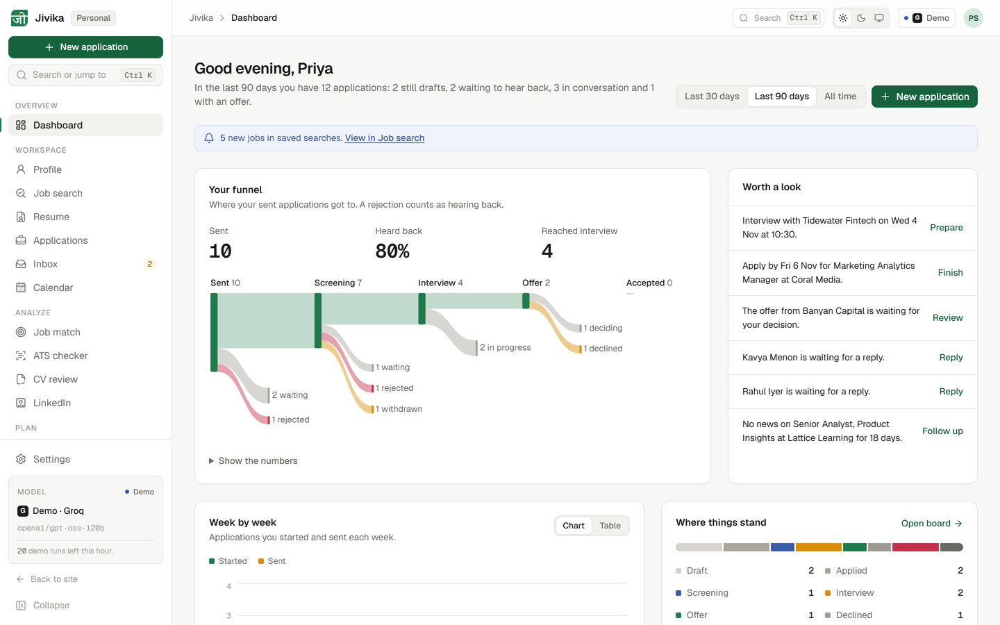
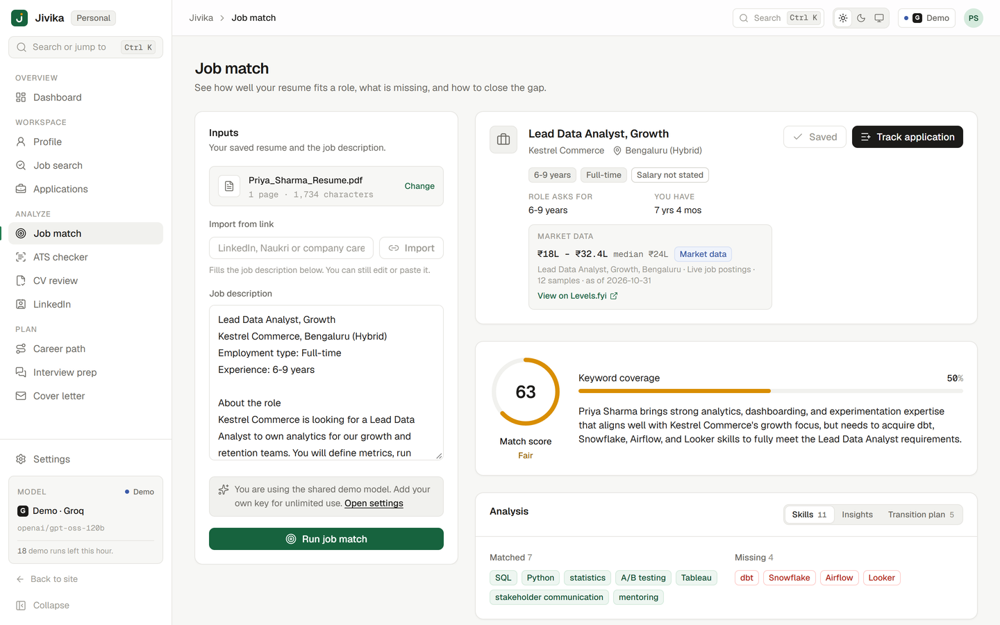
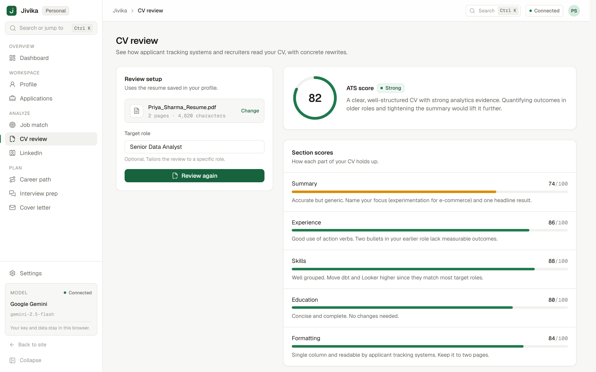
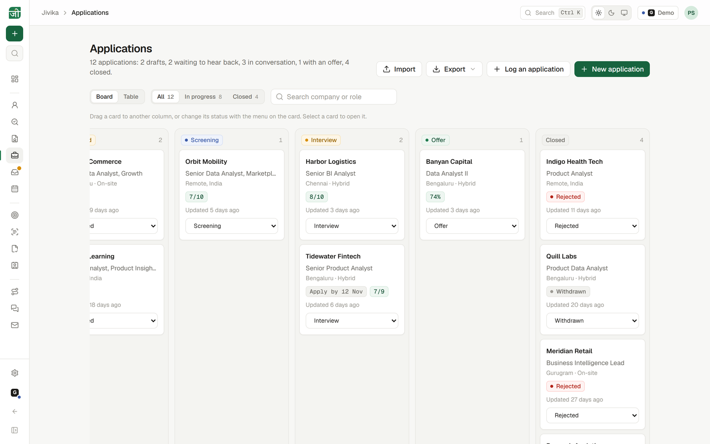
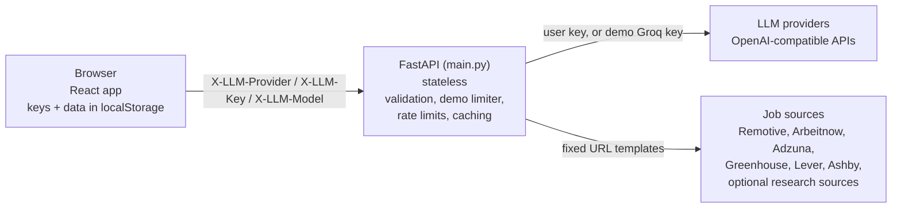

<div align="center">


# Jivika

**A private career workspace for job seekers. Find jobs, match your resume, and prepare for the role you want.**

[Live demo](https://jivika.abhimanyu.fyi) · [App](https://jivika.abhimanyu.fyi/app/) · [Report an issue](https://github.com/abhimanyus1997/Jivika/issues)

[](LICENSE)
[](https://www.python.org/)
[](https://fastapi.tiangolo.com/)
[](https://react.dev/)
[](https://www.typescriptlang.org/)
[](https://vite.dev/)
[](https://tailwindcss.com/)
[](https://jivika.abhimanyu.fyi)



</div>

Jivika (Sanskrit for *livelihood*) searches live job listings, matches your resume against real job descriptions, reviews your CV and LinkedIn profile, maps a career path with estimated salaries, and helps you prepare for interviews and write cover letters. Try it instantly with the free demo model, then bring your own key. There is no account, and your data stays in your browser.

### Works with

<table>
  <tr>
    <td align="center"><br>Google Gemini</td>
    <td align="center"><br>OpenAI</td>
    <td align="center"><br>Anthropic Claude</td>
    <td align="center"><br>Groq</td>
    <td align="center"><br>Mistral AI</td>
    <td align="center"><br>DeepSeek</td>
    <td align="center"><br>xAI Grok</td>
    <td align="center"><br>OpenRouter</td>
  </tr>
</table>

## Features

| Tool | What it does |
| --- | --- |
| Dashboard | Career, skills, CV and LinkedIn scores with history, application trends, a career goals timeline, top job matches and a Get started checklist |
| Job search | Live listings from job boards and company career pages, with source status chips, a client-side Quick fit score against your resume, and one-click Match or Track |
| Job match | Match score (model judgement blended with deterministic keyword coverage), matched and missing skills, strengths, gaps and a step-by-step transition plan |
| CV review | ATS-style score, per-section feedback and rewritten bullet points |
| LinkedIn | Headline suggestions, an About rewrite and keyword recommendations |
| Career path | Current role, next target and long-term potential with estimated salary ranges (INR, USD, GBP, EUR) and skills to build |
| Interview prep | Tailored questions from a job description, with feedback on your answers |
| Cover letter | Tone-aware letters you can edit, copy or download |
| Applications | Track applications and their status; feeds the dashboard trends |

A command palette jumps to any page or action, and the Profile page parses your resume PDF into a structured profile used by every tool.

<table>
  <tr>
    <td width="50%"><br><p align="center">Job match</p></td>
    <td width="50%"><br><p align="center">CV review</p></td>
  </tr>
  <tr>
    <td width="50%"><br><p align="center">Applications</p></td>
    <td width="50%"></td>
  </tr>
</table>

## How it works



- Every AI call goes through the server using the OpenAI SDK against each provider's OpenAI-compatible endpoint. The browser sends the provider, key and model per request in `X-LLM-Provider`, `X-LLM-Key` and `X-LLM-Model`.
- Model responses are validated against Pydantic schemas, with scores clamped to 0 to 100. JSON mode (`response_format: json_object`) is only sent to providers that support it.
- Job search fetches all enabled sources concurrently (8 second timeout and a size cap per source), strips HTML, normalises, dedupes by title and company, and sorts by recency. Responses are cached for 10 minutes.
- In production FastAPI also serves the built frontend from `frontend/dist` and adds security headers (CSP, `X-Frame-Options`, `Referrer-Policy`, `Permissions-Policy`, optional HSTS) to every response. API docs are at `/api/docs`.

### URL structure

| Path | Content |
| --- | --- |
| `/` | Landing page |
| `/pricing/`, `/faq/`, `/about/`, `/contact/` | Marketing pages (static HTML) |
| `/privacy/`, `/terms/` | Privacy policy and terms |
| `/app/` | The React app (hash routes, for example `/app/#jobs`) |
| `/robots.txt`, `/sitemap.xml` | Generated at build time from `VITE_SITE_URL` |
| `/api/*` | JSON API |

Paths without a trailing slash (`/pricing`) redirect to the canonical form (`/pricing/`). Unknown paths return the branded `404.html` with status 404; unknown API paths return a JSON 404.

## Privacy model

- Your API key is kept in the browser (session storage by default, or local storage if you choose "Remember key on this device"). It is sent per request in a header and is never logged, stored or returned by the server.
- Your resume, analyses, applications and last job search are stored only in your browser's local storage. "Clear all local data" in Settings removes everything.
- The demo key is a server-side secret. It is never sent to the browser; `GET /api/demo` reports only whether demo mode is on, the model and the limits.
- The only server-side data is the Pro waitlist (an email address, plan and source, stored in SQLite or Upstash Redis) and short-lived counters for rate limits and demo quotas.

## Tech stack

- **Backend:** Python 3.12, FastAPI, Pydantic v2, OpenAI SDK, pypdf, python-dotenv. Job sources use only the standard library (`urllib`, `html.parser`).
- **Frontend:** React 19, TypeScript, Vite (multi-page build: static marketing pages plus the app), Tailwind CSS v4, Recharts, lucide-react, Geist fonts.
- **Storage:** browser localStorage for user data; SQLite or Upstash Redis for the waitlist and shared counters.
- **Tooling:** uv, pytest, oxlint.
- **Hosting:** Vercel (one Python function serving the API and the built site) or Docker.

## Getting started

### Prerequisites

- Python 3.11+ (3.12 recommended) and [uv](https://docs.astral.sh/uv/)
- Node.js 20.19+ or 22.12+

### Install and run

```bash
uv sync
npm --prefix frontend install
npm run build                 # builds frontend/dist
npm start                     # uv run uvicorn main:app
```

Open http://127.0.0.1:8000 for the site or http://127.0.0.1:8000/app/ for the app. Without any configuration, go to **Settings**, choose a provider and paste your API key. To let visitors try the tools without a key, set `JIVIKA_DEMO_GROQ_KEY` (see [Demo mode](#demo-mode)).

### Development

Run the API and the Vite dev server in two terminals:

```bash
npm run api                   # http://127.0.0.1:8000, with --reload
npm run dev                   # http://localhost:5173 (site) and /app/ (app); proxies /api
```

The server loads a `.env` file from the repository root at startup. Copy [.env.example](.env.example) to `.env` to configure it locally.

## Configuration

All settings are optional. See [.env.example](.env.example) for the full annotated list.

### Server environment

| Variable | Default | Purpose |
| --- | --- | --- |
| `JIVIKA_DB_PATH` | `./data/jivika.db` (`/data/jivika.db` in Docker) | SQLite file for the Pro waitlist |
| `KV_REST_API_URL`, `KV_REST_API_TOKEN` | unset | Upstash Redis REST credentials (Vercel Marketplace names). Used for the waitlist and demo counters. `UPSTASH_REDIS_REST_URL` and `UPSTASH_REDIS_REST_TOKEN` also work. On Vercel the waitlist returns 503 without them |
| `JIVIKA_BASE_PATH` | unset | Serve the whole app under a sub-path such as `/jivika`; other paths redirect into it. Build the frontend with the matching `VITE_BASE_PATH` |
| `JIVIKA_ADMIN_TOKEN` | unset | Bearer token for `GET /api/admin/waitlist.csv`; the endpoint returns 404 when unset |
| `JIVIKA_TRUST_PROXY` | unset | Set to `1` behind a reverse proxy to rate limit by the client IP it reports (`X-Vercel-Forwarded-For` or `X-Real-IP` on Vercel, otherwise the last `X-Forwarded-For` entry, the one the trusted proxy appended). Leave unset when the app is reachable directly |
| `JIVIKA_RATE_LIMIT` | `5` | Waitlist sign-ups allowed per client IP per 10 minutes |
| `JIVIKA_HSTS` | unset | Set to `1` when served over HTTPS to send `Strict-Transport-Security` |
| `JIVIKA_CORS_ORIGINS` | unset | Comma-separated origins, only if the frontend is served from another origin |
| `JIVIKA_MAX_UPLOAD_MB` | `10` | Maximum resume PDF size. Use `4` on Vercel |

### Build-time frontend values

Baked in at build time. Defaults live in `frontend/.env`; override them with environment variables when running `npm run build`, or with `--build-arg` for Docker.

| Variable | Default | Purpose |
| --- | --- | --- |
| `VITE_SITE_URL` | `https://jivika.app` | Canonical URLs, Open Graph tags and sitemap. Include any sub-path, without a trailing slash |
| `VITE_BASE_PATH` | `/` | Sub-path the site is served from, such as `/jivika/`; links, assets and API calls are prefixed with it |
| `VITE_CONTACT_EMAIL` | `abhimanyus1997@gmail.com` | Contact links |
| `VITE_COMPANY_NAME` | `Jivika` | Footer and legal pages |

In Git Bash on Windows, path-like values such as `/jivika/` are rewritten to Windows paths. Prefix the command with `MSYS_NO_PATHCONV=1` (for example `MSYS_NO_PATHCONV=1 VITE_BASE_PATH=/jivika/ npm run build`), or set the variables in PowerShell. Vercel builds on Linux and is not affected.

For sub-path development, run `npm run dev` with `VITE_BASE_PATH` set and the API at root (`npm run api` without `JIVIKA_BASE_PATH`); the dev proxy strips the prefix.

### Demo mode

When a demo key is configured, requests that carry no `X-LLM-Key` use Groq with the demo model. Any provider or model the client sends is ignored. Requests with a user key are never counted against demo limits. With no demo key and no user key, AI endpoints return 401.

| Variable | Default | Purpose |
| --- | --- | --- |
| `JIVIKA_DEMO_GROQ_KEY` | empty (demo off) | Owner-supplied Groq key. Server-side secret; set it in your host's environment settings, never in the frontend |
| `JIVIKA_DEMO_MODEL` | `openai/gpt-oss-120b` | Groq model used for demo requests |
| `JIVIKA_DEMO_HOURLY_LIMIT` | `20` | Demo requests per client IP per clock hour |
| `JIVIKA_DEMO_DAILY_LIMIT` | `500` | Demo requests for everyone per UTC day |

Counters use Upstash Redis (`INCR` + `EXPIRE`) when `KV_REST_API_URL`/`KV_REST_API_TOKEN` are set, otherwise bounded in-memory counters per process. Demo responses carry `X-Jivika-Demo: 1` and `X-Jivika-Demo-Remaining: <n>`. Over a limit, the API returns 429 with "Demo limit reached. Add your own API key in Settings to keep going." `GET /api/demo` returns `{enabled, provider, provider_name, model, hourly_limit, daily_limit, remaining_hourly}` and never includes the key.

### Job search sources

`GET /api/jobs/search?q=&location=&remote=any|remote|onsite&sources=&page=1..5` queries the enabled sources. `GET /api/jobs/detail?source=linkedin&id=` fetches a full description when a source's search results lack one.

| Source | Enabled by default | Notes |
| --- | --- | --- |
| `remotive` | yes | Remote roles from the Remotive public API |
| `arbeitnow` | yes | Arbeitnow public job board feed, filtered on the server |
| `adzuna` | when keys are set | Adzuna search API; needs `JIVIKA_ADZUNA_APP_ID` and `JIVIKA_ADZUNA_APP_KEY` |
| `ats` | yes | Company career boards on Greenhouse, Lever and Ashby, cached for 30 minutes |
| `linkedin` | no (research) | Public guest job listings, fetched on demand |
| `naukri` | no (research) | Public search API used by the Naukri web client, fetched on demand |

| Variable | Default | Purpose |
| --- | --- | --- |
| `JIVIKA_JOB_SOURCES` | `remotive,arbeitnow,adzuna,ats` | Sources to use. Research sources must be listed explicitly, for example `remotive,arbeitnow,adzuna,ats,linkedin,naukri` |
| `JIVIKA_ADZUNA_APP_ID`, `JIVIKA_ADZUNA_APP_KEY` | unset | Free keys from https://developer.adzuna.com |
| `JIVIKA_ADZUNA_COUNTRY` | `in` | Two-letter Adzuna country code |
| `JIVIKA_ATS_BOARDS` | built-in list in `jivika/jobs.py` | Comma-separated `greenhouse:<slug>`, `lever:<slug>` or `ashby:<slug>` |
| `JIVIKA_JOBS_RATE_LIMIT` | `30` | Job searches per client IP per 10 minutes |

Research sources use no login, cookies, proxies or captcha solving. If a source blocks the request, it is reported as unavailable rather than retried. Only fixed URL templates are used, so user input never selects a host.

## Deployment

### Vercel

The production deployment serves Jivika at the root of `https://jivika.abhimanyu.fyi`. The portfolio site redirects `https://abhimanyu.fyi/jivika/*` there permanently.

1. **Create the project.** In Vercel, choose **Add New > Project** and import this repository. `vercel.json` sets the framework preset (FastAPI), the build command (`npm --prefix frontend ci && npm run build`) and the function settings, so leave Root Directory empty and the other build settings at their defaults. Vercel installs Python dependencies from `pyproject.toml` and `uv.lock`.
2. **Add storage.** Under **Storage**, add **Upstash for Redis** from the Marketplace and connect it to the project. This sets `KV_REST_API_URL` and `KV_REST_API_TOKEN`, used by the waitlist and the demo counters.
3. **Set environment variables** (Production, and Preview if you use it), then redeploy:

   | Variable | Value |
   | --- | --- |
   | `VITE_SITE_URL` | `https://jivika.abhimanyu.fyi` |
   | `JIVIKA_MAX_UPLOAD_MB` | `4` (Vercel rejects request bodies over 4.5 MB) |
   | `JIVIKA_TRUST_PROXY` | `1` |
   | `JIVIKA_HSTS` | `1` |
   | `JIVIKA_ADMIN_TOKEN` | a long random value, for the waitlist export |
   | `JIVIKA_DEMO_GROQ_KEY` | optional, a Groq key to enable demo mode (mark it Sensitive) |

4. **Add the domain.** In **Settings > Domains**, add `jivika.abhimanyu.fyi` and create the DNS record Vercel shows (a CNAME to the project's `vercel-dns` target).
5. **Redirect old links (optional).** In the portfolio project's `vercel.json`:

   ```json
   {
     "redirects": [
       { "source": "/jivika", "destination": "https://jivika.abhimanyu.fyi/", "permanent": true },
       { "source": "/jivika/(.*)", "destination": "https://jivika.abhimanyu.fyi/$1", "permanent": true }
     ]
   }
   ```

6. **Check it.** `https://jivika.abhimanyu.fyi/`, `/app/` and `/api/health` should return 200.

To serve Jivika under a sub-path instead (for example `https://example.com/jivika`), build with `VITE_BASE_PATH=/jivika/` and `VITE_SITE_URL=https://example.com/jivika`, run with `JIVIKA_BASE_PATH=/jivika`, and proxy that prefix to the project with rewrites that keep the prefix (`/jivika` and `/jivika/(.*)` to `https://<project>.vercel.app/jivika/$1`).

Notes:

- The app runs as one Python function with `maxDuration` 300 seconds, which covers slow model calls. The built frontend in `frontend/dist` is bundled into the function and served by FastAPI, so security headers and the branded 404 apply to every page.
- In-memory limits (waitlist, job search, and demo counters without Redis) are per function instance, so they are best-effort on Vercel. If the portfolio rewrite hides the visitor IP, every visitor shares one limit; raise `JIVIKA_RATE_LIMIT` in that case.
- Vercel Hobby is for non-commercial use. Move the project to Pro before charging customers.

### Docker

The image builds the frontend and runs the API as a non-root user. The waitlist database lives on the `/data` volume.

```bash
docker build -t jivika --build-arg VITE_SITE_URL=https://your-domain.example .
export JIVIKA_ADMIN_TOKEN="$(python -c 'import secrets; print(secrets.token_urlsafe(32))')"
docker run -d --name jivika -p 8000:8000 \
  -v jivika-data:/data \
  -e JIVIKA_ADMIN_TOKEN \
  -e JIVIKA_TRUST_PROXY=1 -e JIVIKA_HSTS=1 \
  jivika
```

Add `-e JIVIKA_DEMO_GROQ_KEY` (with the variable exported in your shell) to enable demo mode. The image works on Render, Railway, Fly.io or any VPS behind a TLS-terminating proxy. It listens on `$PORT` when the platform sets it and on 8000 otherwise, and has a health check on `/api/health`. Rate limits are kept in memory, so run a single worker per instance.

### Exporting the waitlist

```bash
curl -fsS -H "Authorization: Bearer $JIVIKA_ADMIN_TOKEN" \
  https://your-domain.example/api/admin/waitlist.csv -o waitlist.csv
```

To delete an address on request (SQLite; with Redis, run `HDEL jivika:waitlist person@example.com` in the Upstash console):

```bash
docker exec jivika python -c "import sqlite3; c = sqlite3.connect('/data/jivika.db'); c.execute('DELETE FROM waitlist WHERE email = ?', ('person@example.com',)); c.commit()"
```

## Project structure

```
.
├── main.py               FastAPI app: routes, BYOK and demo handling, rate limits, static site serving
├── jivika/
│   ├── schemas.py        Providers, Pydantic schemas and prompts
│   └── jobs.py           Job sources, parsers, filtering and caching
├── tests/                pytest suite (network blocked; model and fetch calls are faked)
├── frontend/
│   ├── index.html        Landing page; pricing/, faq/, about/, contact/, privacy/, terms/ alongside
│   ├── app/index.html    React app entry
│   ├── partials/         Shared HTML (header, footer, providers strip, pricing cards)
│   ├── public/           favicon, screenshots (img/) and provider icons (providers/)
│   ├── src/
│   │   ├── App.tsx       App shell, navigation and command palette
│   │   ├── pages/        Dashboard, JobSearch, JobMatch, CvReview, LinkedIn, CareerPath, ...
│   │   ├── components/   UI kit, charts, resume upload, command palette
│   │   ├── lib/          API client and local storage
│   │   ├── assets/providers/  Provider icons for the app
│   │   └── site/         Script and styles for the marketing pages
│   └── vite.config.ts    Multi-page build, partials, robots.txt and sitemap
├── Dockerfile
├── vercel.json
├── pyproject.toml, uv.lock
└── .env.example
```

## Testing

```bash
uv run pytest                 # backend tests; no network access
npm --prefix frontend run lint
npm run build                 # type-checks and builds the frontend
```

## Roadmap

- **Pro hosted plan** with accounts and payments, so no key is needed. Join the waitlist on the pricing page.
- **Browser extension** to clip jobs from any site into Applications and Job match.
- **More ATS boards** and job sources.

## Responsible use

- **Job listings** come from third-party job boards and company career pages and are shown as-is, with links to the original posting. Jivika does not verify them. The optional research sources fetch publicly available listings on demand, may be unavailable at any time, and can be disabled with `JIVIKA_JOB_SOURCES`. Respect each source's terms when enabling them.
- **Model output** is generated by third-party AI models and can be wrong or incomplete. Scores, salary estimates and suggestions are guidance, not advice; review anything before you send it to an employer.

## Trademarks

Product names and logos are trademarks of their respective owners and are used only to indicate compatibility.

## License

Licensed under the [Apache License 2.0](LICENSE). Copyright 2025-2026 Abhimanyu Singh.

## Author

**Abhimanyu Singh** · [abhimanyu.fyi](https://abhimanyu.fyi) · [GitHub](https://github.com/abhimanyus1997)
